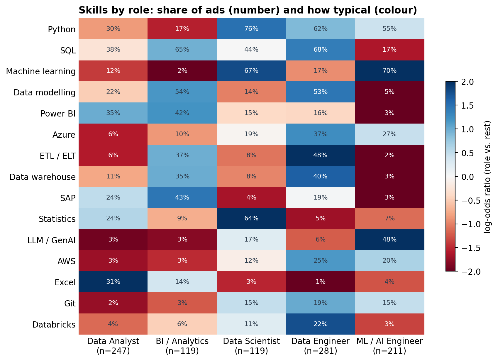
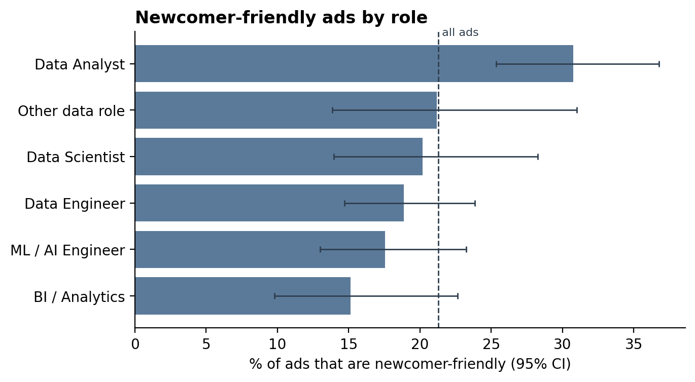
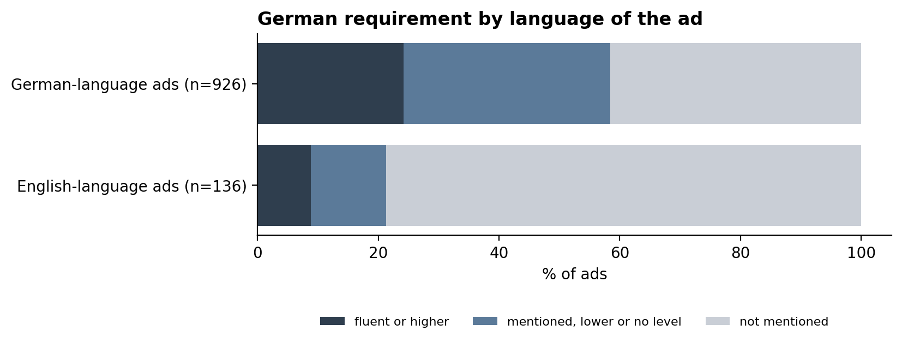

# What Does It Take to Get a Data Job in Germany?

A text-mining project on German job ads, with data roles as the case study: turning
unstructured ad texts into structured information about roles, skills and entry
requirements, and checking each extraction step against human judgement. The ads are
collected from the job search platform of the Bundesagentur für Arbeit (German
Federal Employment Agency).


[](https://data-jobs-de.streamlit.app/)

**Live app: [data-jobs-de.streamlit.app](https://data-jobs-de.streamlit.app/)** — click the skills you have and see which data role fits you best and what to learn next.

## Project Overview

**Problem.** Job ads for data roles list long and varied requirements. For
people entering the field — graduates and career switchers — it is hard to tell
which skills are really required, which are only nice to have, and how open
employers are to newcomers.

**Goal.** Collect job ads for data roles in Germany and answer three questions
from the perspective of a newcomer:

1. Which skills are required, and which are only nice to have?
2. How open are ads to newcomers — in terms of experience, degree and German
   level?
3. How do expectations differ between data roles (Analyst, Scientist, Engineer,
   BI, ML / AI) and between junior and senior ads?

**Approach.** The project turns unstructured job ad texts into structured information about data roles, 
skills and entry requirements:
- **Data collection** via API, with retries and resumable downloads.
- **Near-duplicate detection** with text similarity to identify and remove repeated ads.
- **Rule-based text classification** of job titles, evaluated against a hand-labelled sample by two annotators (precision, recall, Cohen's kappa).
- **Skill and requirement extraction** from German and English ad texts with a regex dictionary, including German compounds like "Pythonkenntnisse".
- **Hedge detection** to separate required from nice-to-have skills, using cue words ("von Vorteil", "a plus") and section headings.
- **Language identification** of each ad (German or English) with a function-word count, cross-checked with a statistical language detector (lingua).
- **Human validation** of every extraction step with stratified spot checks, instead of checking automated output with another model.
- **Statistical comparison** of roles and seniority levels: shares with Wilson confidence intervals, log-odds ratios for role-typical skills, Fisher's exact test for the small junior group (Benjamini–Hochberg adjusted).
- **Robustness checks:** results recomputed with duplicates weighted, old ads removed and every employer weighted equally.

**Product.** A [web app](https://data-jobs-de.streamlit.app/) for career switchers and newcomers that works in two directions:

- **Skills → roles:** click your skills and see how well you fit each data role, which key skills you already have, and the three to learn next.
- **Role → skills:** choose a role and see its must-have and bonus skills, and how open it is to beginners (experience, degree, German).

## Data

| | |
|---|---|
| **Source** | Job search of the Bundesagentur für Arbeit |
| **Collected** | 7 October 2026 |
| **Search terms** | Data Analyst, Datenanalyst, Data Scientist, Data Engineer, Dateningenieur, Business Intelligence, Machine Learning |
| **Size** | 2,119 ads with full text (2,542 search results, 2,121 after duplicate removal; 2 ads expired before their text could be fetched) |
| **After cleaning** | 1,957 ads (2,031 with a location in Germany; 32 exact and 42 near-duplicate copies removed) |
| **Data roles** | 1,068 ads pass the title rule; 1,062 after removing ads that matched only through an employer name ("NTT DATA") |
| **Content** | Title, employer, location, contract type, home office option, publication date, full ad text |

The Bundesagentur does not offer an official public API. Access follows the
documentation of the community project [bundesAPI](https://github.com/bundesAPI/jobsuche-api). 
*Note: Because the interface is unofficial, it may change without notice.*

The raw data is **not** included in this repository: the ads belong to the
Bundesagentur and the publishing employers. Running the collection notebook
recreates the dataset. Since the job market changes daily, a new run will return
a different set of ads.

## Findings

### Data-role filter

A search for data jobs does not return only data jobs, so ads are filtered with a
rule on the **job title** (not the ad text, which would make the later skill counts
confirm the selection). The rule was evaluated against a random sample of 100
hand-labelled ads:

| | Version 1 | Version 3 (final) |
|---|---|---|
| Precision | 0.79 | **0.88** |
| Recall | 0.85 | **0.85** (44 of 52 data roles) |
| Ads kept | 1,104 | **1,068** |

A second annotator (a senior data analyst) labelled 30 of the ads independently with
the same codebook. Agreement was only fair (Cohen's kappa 0.37 for three categories,
0.35 binary): the boundary between a data role and an adjacent role (e.g. data
governance, teaching) is unclear even for humans. This is reported as a limitation.

### Roles, seniority and skills

- **Roles (from the title):** Data Engineer 281, Data Analyst 247, ML / AI 211,
  BI 119, Data Scientist 119, other 85.
- **Seniority is rarely stated.** Only 55 titles say junior, 250 say senior, and
  757 give no level, so for newcomers the requirements in the ad text matter more
  than the title.
- **Skills** are extracted with a dictionary of 46 skills (German and English
  variants). A stratified spot check found 108 of 110 hits correct.
- **Python (46%) and SQL (44%)** are the most frequent skills, followed by machine
  learning and data modelling (30% each).


### Required vs. nice-to-have

A mention counts as *nice-to-have* if the sentence or bullet contains a hedge cue
("von Vorteil", "idealerweise", "a plus") or sits under a heading such as
"Nice-to-have". A spot check of 30 mentions found 28 correct. **Python and SQL are
required in more than 80% of their mentions**, while tools such as Airflow and
Kafka are more often only a plus (27% of mentions).

### Each role has a clear skill profile

The most typical skills of each role (log-odds ratio, role vs. all other ads):

| Role | Most typical skills |
|---|---|
| Data Analyst | Excel, Tableau, Power BI, R, statistics |
| BI / Analytics | Qlik, DAX / Power Query, SAP, Power BI, data modelling |
| Data Scientist | statistics, scikit-learn, machine learning, pandas, Python |
| Data Engineer | Kafka, Airflow, dbt, Spark, ETL / ELT |
| ML / AI Engineer | TensorFlow, LLM / GenAI, PyTorch, deep learning, machine learning |

These profiles match common role descriptions, which also supports the title-based
role assignment.



### Entry barriers: experience, not the degree, separates junior from senior ads

Experience, degree and German level are extracted from the ad text (53 of 58
manually checked items correct). Most ads give no number of years (613 of 1,062),
and 282 ask for "several years". 821 ads mention a university degree, but 338 also
name an alternative path ("oder vergleichbare Qualifikation").

- **Junior titles lower the experience bar:** only 3.6% of junior ads ask for three
  or more (or "several") years, compared with 62.8% of senior ads, and 49.1% contain
  an entry signal ("Berufseinsteiger", "erste Erfahrung"; senior: 4.0%). Both
  differences are significant (Fisher's exact test, adjusted p < 0.001).
- **They do not lower the degree bar:** a degree is mentioned in 81.8% of junior and
  68.0% of senior ads (not significant after adjustment, with only 55 junior ads).
- **Data Analyst is the most accessible role:** 30.8% of its ads are
  newcomer-friendly (junior title, entry signal or at most 1–2 years), compared with
  21.3% overall. It is the only role whose 95% confidence interval lies above the
  average.



### German: the language of the ad matters

46% of the ads do not mention German at all, but most of these are written in German
and expect it implicitly. The language of each ad was identified with two methods,
which agree on 1,061 of 1,062 ads.

- **136 ads (12.8%) are written in English**, and 78.7% of them do not mention German.
  That leaves about one ad in ten (107 of 1,062) that is in English and states no
  German requirement.
- **English-language ads are most common for ML / AI (18.5%) and Data Analyst
  (15.8%)**, and rare for BI / Analytics (3.4%).
- **German level is grouped by the common German CV scale**, in which "gute" and
  "sehr gute Kenntnisse" form one level and "fließend" is the next step. A native
  speaker reviewed the scale and the hedge words. Fluent German or higher is
  required in 22.2% of all ads.



### The results are robust

Weighting ads by their duplicates, leaving out the 38 ads older than a year, or
weighting each of the 639 employers equally changes the newcomer-friendly share by
at most 0.2 percentage points (21.1–21.4% vs. 21.3%). Skill shares keep almost the
same ranking (Spearman 0.985–0.999); the largest change is 4.1 percentage points
(Python, with employers weighted equally).

### From data collection

- **German and English titles find different ads.** "Datenanalyst" found 10 ads
  that "Data Analyst" did not — over half of its results. For "Dateningenieur",
  all results were also found by "Data Engineer".
- **Skills appear throughout the ad, not only in the requirements.** Task
  descriptions already name tools such as Power BI, SQL and DAX, so skill
  extraction must cover the full text.
- **Some duplicates are invisible to the reference number.** Recruitment
  agencies sometimes post the same job twice under different IDs; these must be
  removed by comparing texts.
- A data search does not return only data jobs. Only 57% of the cleaned ads have a data 
term in the title. The official occupation code is not a reliable filter either: some ads 
coded as data occupations are hardware or mechanical engineering jobs.

## The Web App

**[data-jobs-de.streamlit.app](https://data-jobs-de.streamlit.app/)** · built with Streamlit, deployed on Streamlit Community Cloud.

**From analysis to app.** `04_analysis.ipynb` exports two aggregated tables, and the app computes everything from them; no ad text reaches the app.

| Table | Rows | Content |
|---|---|---|
| `app/data/role_skills.csv` | 276 (6 roles × 46 skills) | share of each role's ads that mention, require, or only hedge each skill |
| `app/data/role_barriers.csv` | 6 (one per role) | newcomer-friendly, 3+ years, degree, alternative path, fluent German, English-language ad |

**How the fit score works.**

1. A role's **key skills** are those required in at least 1 in 10 of its ads.
2. Each key skill is **weighted** by how often it is required.
3. **Fit score** = weights of the key skills you have ÷ weights of all key skills. Labels: at least 60% *Strong fit*, 40–60% *Good start*, 20–40% *Some overlap*, below 20% *Little overlap*.

*Example:* with Python, SQL, Excel and Statistics, Data Analyst has 8 key skills; the four selected ones are required in 32.0%, 25.1%, 23.5% and 21.1% of Data Analyst ads (sum 101.7), all eight sum to 181.3, so the fit is 101.7 ÷ 181.3 = 56% (*Good start*). The most required missing skill is Power BI (28.3%), shown as "3 in 10 ads".

**Design decisions.**

- **Natural frequencies:** shares are shown as "3 in 10 ads" with an icon array of 10 squares instead of percentages, which is easier to read for non-experts.
- **Accessible colours:** light and dark themes based on Fabio Crameri's scientific colour map *oslo*, readable with colour-vision deficiencies.
- **Privacy:** only aggregated numbers are published; the ad texts stay out of the repository.

## Limitations

- **Data source:** a snapshot of one day from one platform (Bundesagentur für Arbeit);
  ads on LinkedIn, StepStone and company sites are not included. Results describe
  this sample, not the whole market.
- **Fuzzy boundary of "data role":** two annotators agreed only fairly (kappa 0.37).
- **Rules, not a model:** the dictionary only finds what it lists. Every step is
  spot-checked by hand to measure how much this matters.
- **Scope of hedge cues:** "von Vorteil" can refer to a different skill in the same
  sentence, so a required skill may be counted as nice-to-have. The same applies to
  German level words ("Fluent English required, German skills are a plus").
- **Degree mentioned, not required:** "idealerweise ein Studium" counts as a degree.
- **German level scale:** the grouping follows a common CV convention, not an
  official standard.
- **Small junior group:** only 55 ads have a junior title, so differences need
  large effects to be significant.
- **Rounding in the app:** "3 in 10 ads" rounds to whole tenths, so small differences
  disappear (25% and 34% both show as 3 in 10); exact values are in the app's tables.

## Future Work

- Syntactic analysis to resolve which skill a hedge cue refers to
- A text classifier (e.g. TF-IDF + logistic regression) as a comparison to the rule-based baseline
- A second labelling round with a sharper codebook for adjacent roles
- Skill co-occurrence networks
- Regular collection to track changes over time

## Project Structure

```
data-job-ad-nlp-de/
├── data/
│   ├── raw/                  # collected ads (not in the repository)
│   └── processed/            # cleaned data (not in the repository)
├── notebooks/
│   ├── 00_api_test.ipynb     # testing the data source
│   ├── 01_collect.ipynb      # collecting search results and full texts
│   ├── 02_cleaning.ipynb     # cleaning, data-role filter and its evaluation
│   ├── 03_extraction.ipynb   # roles, seniority, skills, required vs. nice-to-have, entry barriers, ad language
│   └── 04_analysis.ipynb     # confidence intervals, role comparison, junior vs. senior, robustness checks
├── app/
│   ├── app.py                # Streamlit web app
│   ├── requirements.txt      # app dependencies for Streamlit Community Cloud
│   └── data/                 # aggregated tables for the web app (no ad texts)
├── .streamlit/
│   └── config.toml           # app themes (light and dark)
├── reports/
│   └── figures/              # charts used in the README and report
├── src/                      # helper from the course template (not used by the notebooks)
├── pyproject.toml            # dependencies (managed with uv)
└── README.md
```

## Getting Started

Requires [uv](https://docs.astral.sh/uv/).

```bash
git clone https://github.com/zeqizhao12/data-job-ad-nlp-de.git
cd data-job-ad-nlp-de
uv sync
```

Then run the notebooks in order. `01_collect.ipynb` downloads the data into
`data/raw/`; the full collection takes about 35 minutes.

The web app runs without the raw data, from the aggregated tables in `app/data/`:

```bash
uv run streamlit run app/app.py
```

## Tech Stack

- **Language:** Python 3.13
- **Data collection:** requests
- **Data processing:** pandas, regular expressions
- **Visualisation:** matplotlib
- **Environment:** uv, Jupyter, VS Code
- **Version control:** Git, GitHub
- **Statistics:** SciPy
- **Language identification:** lingua
- **Web app:** Streamlit, deployed on Streamlit Community Cloud

## Progress

- [x] Project setup
- [x] Data source tested
- [x] Data collection
- [x] Text cleaning
- [x] Location filter, exact and near-duplicate removal
- [x] Data-role filter, evaluated against 100 hand-labelled ads and a second annotator
- [x] Role and seniority assignment
- [x] Skill extraction (46 skills) and required vs. nice-to-have split
- [x] Entry barriers: experience, degree, German level, ad language
- [x] Analysis: shares with confidence intervals, role comparison, junior vs. senior, robustness checks
- [x] Web app: skills → roles, role → skills ([live](https://data-jobs-de.streamlit.app/))
- [x] Final presentation (23 October 2026)

## Author

**Zeqi Zhao** — PhD in linguistics (Georg-August-Universität Göttingen),
transitioning into data science.

[Website](https://zeqizhao12.github.io/) ·
[LinkedIn](https://www.linkedin.com/in/zeqi-zhao-13a392402)

This project was created as part of the StackFuel Data Science portfolio
programme.
