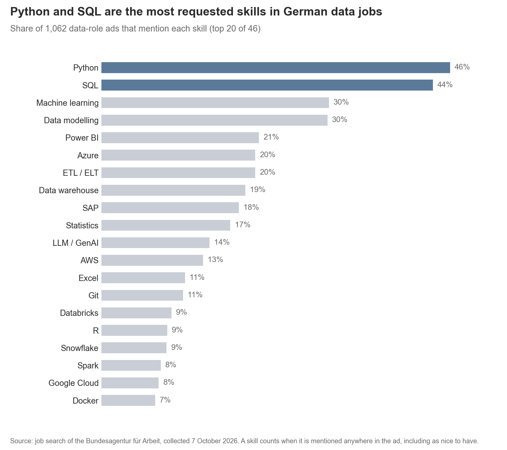

# What Does It Take to Get a Data Job in Germany?

A text-mining project on German job ads, with data roles as the case study: turning
unstructured ad texts into structured information about roles, skills and entry
requirements, and checking each extraction step against human judgement. The ads are
collected from the job search platform of the Bundesagentur für Arbeit (German
Federal Employment Agency).


## Project Overview

**Problem.** Job ads for data roles list long and varied requirements. For
people entering the field — graduates and career switchers — it is hard to tell
which skills are really required, which are only nice to have, and how open
employers are to newcomers.

**Goal.** Collect job ads for data roles in Germany and answer three questions
from the perspective of a newcomer:

1. Which skills are required, and which are only nice to have?
2. How open are ads to newcomers — in terms of experience, degree and German
   level?
3. How do expectations differ between data roles (Analyst, Scientist, Engineer,
   BI, ML / AI) and between junior and senior ads?

**Approach.** The project turns unstructured job ad texts into structured information about data roles, 
skills and entry requirements:
- **Data collection** via API, with retries and resumable downloads.
- **Near-duplicate detection** with text similarity to identify and remove repeated ads.
- **Rule-based text classification** of job titles, evaluated against a hand-labelled sample by two annotators (precision, recall, Cohen's kappa).
- **Skill and requirement extraction** from German and English ad texts with a regex dictionary, including German compounds like "Pythonkenntnisse".
- **Hedge detection** to separate required from nice-to-have skills, using cue words ("von Vorteil", "a plus") and section headings.
- **Human validation** of every extraction step with stratified spot checks, instead of checking automated output with another model.
- **Statistical comparison** of roles and seniority levels: shares with Wilson confidence intervals, log-odds ratios for role-typical skills, Fisher's exact test for the small junior group.

**Planned product.** A small web app that works in two directions:

- **Skills → roles:** enter your skills and see which data roles match them best, and which required skills are still missing.
- **Role → skills:** choose a role and see its most required and nice-to-have skills.

## Data

| | |
|---|---|
| **Source** | Job search of the Bundesagentur für Arbeit |
| **Collected** | 7 October 2026 |
| **Search terms** | Data Analyst, Datenanalyst, Data Scientist, Data Engineer, Dateningenieur, Business Intelligence, Machine Learning |
| **Size** | 2,119 ads with full text (2,542 search results, 2,121 after duplicate removal; 2 ads expired before their text could be fetched) |
| **After cleaning** | 1,957 ads (2,031 with a location in Germany; 32 exact and 42 near-duplicate copies removed) |
| **Data roles** | 1,068 ads pass the title rule; 1,062 after removing ads that matched only through an employer name ("NTT DATA") |
| **Content** | Title, employer, location, contract type, home office option, publication date, full ad text |

The Bundesagentur does not offer an official public API. Access follows the
documentation of the community project [bundesAPI](https://github.com/bundesAPI/jobsuche-api). 
*Note: Because the interface is unofficial, it may change without notice.*

The raw data is **not** included in this repository: the ads belong to the
Bundesagentur and the publishing employers. Running the collection notebook
recreates the dataset. Since the job market changes daily, a new run will return
a different set of ads.

## Findings So Far (subject to change)

### Data-role filter

A search for data jobs does not return only data jobs, so ads are filtered with a
rule on the **job title** (not the ad text, which would make the later skill counts
confirm the selection). The rule was evaluated against a random sample of 100
hand-labelled ads:

| | Version 1 | Version 3 (final) |
|---|---|---|
| Precision | 0.79 | **0.88** |
| Recall | 0.85 | **0.85** (44 of 52 data roles) |
| Ads kept | 1,104 | **1,068** |

A second annotator (a senior data analyst) labelled 30 of the ads independently with
the same codebook. Agreement was only fair (Cohen's kappa 0.37 for three categories,
0.35 binary): the boundary between a data role and an adjacent role (e.g. data
governance, teaching) is unclear even for humans. This is reported as a limitation.

### Roles, seniority and skills

- **Roles (from the title):** Data Engineer 281, Data Analyst 247, ML / AI 211,
  BI 119, Data Scientist 119, other 85.
- **Seniority is rarely stated.** Only 55 titles say junior, 250 say senior, and
  757 give no level, so for newcomers the requirements in the ad text matter more
  than the title.
- **Skills** are extracted with a dictionary of 46 skills (German and English
  variants). A stratified spot check found 108 of 110 hits correct.
- **Python (46%) and SQL (44%)** are the most frequent skills, followed by machine
  learning and data modelling (30% each).



### Required vs. nice-to-have

A mention counts as *nice-to-have* if the sentence or bullet contains a hedge cue
("von Vorteil", "idealerweise", "a plus") or sits under a heading such as
"Nice-to-have". A spot check of 30 mentions found 28 correct. **Python and SQL are
required in more than 80% of their mentions**, while tools such as Airflow and
Kafka are more often only a plus (27% of mentions).

### Entry barriers (in progress)

Experience (years or "mehrjährig"), degree, PhD, alternative paths ("or equivalent
qualification") and German level are extracted. German level is categorised by the
wording of the ad ("fließend", "sehr gut", "gut", CEFR level if stated), because
descriptions like "gute Deutschkenntnisse" cannot be mapped to CEFR levels. A second
manual check is in progress.

### From data collection

- **German and English titles find different ads.** "Datenanalyst" found 10 ads
  that "Data Analyst" did not — over half of its results. For "Dateningenieur",
  all results were also found by "Data Engineer".
- **Skills appear throughout the ad, not only in the requirements.** Task
  descriptions already name tools such as Power BI, SQL and DAX, so skill
  extraction must cover the full text.
- **Some duplicates are invisible to the reference number.** Recruitment
  agencies sometimes post the same job twice under different IDs; these must be
  removed by comparing texts.
- A data search does not return only data jobs. Only 57% of the cleaned ads have a data 
term in the title. The official occupation code is not a reliable filter either: some ads 
coded as data occupations are hardware or mechanical engineering jobs.

## Limitations

- **Data source:** a snapshot of one day from one platform (Bundesagentur für Arbeit);
  ads on LinkedIn, StepStone and company sites are not included. Results describe
  this sample, not the whole market.
- **Fuzzy boundary of "data role":** two annotators agreed only fairly (kappa 0.37).
- **Rules, not a model:** the dictionary only finds what it lists. Every step is
  spot-checked by hand to measure how much this matters.
- **Scope of hedge cues:** "von Vorteil" can refer to a different skill in the same
  sentence, so a required skill may be counted as nice-to-have.

## Future Work

- Syntactic analysis to resolve which skill a hedge cue refers to
- A text classifier (e.g. TF-IDF + logistic regression) as a comparison to the rule-based baseline
- A second labelling round with a sharper codebook for adjacent roles
- Skill co-occurrence networks

## Project Structure

```
data-job-ad-nlp-de/
├── data/
│   ├── raw/                  # collected ads (not in the repository)
│   └── processed/            # cleaned data (not in the repository)
├── notebooks/
│   ├── 00_api_test.ipynb     # testing the data source
│   ├── 01_collect.ipynb      # collecting search results and full texts
│   ├── 02_cleaning.ipynb     # cleaning, data-role filter and its evaluation
│   └── 03_extraction.ipynb   # roles, seniority, skills, required vs. nice-to-have, entry barriers
├── reports/
│   └── figures/              # charts used in the README and report
├── src/                      # reusable code
├── pyproject.toml            # dependencies (managed with uv)
└── README.md
```

## Getting Started

Requires [uv](https://docs.astral.sh/uv/).

```bash
git clone https://github.com/zeqizhao12/data-job-ad-nlp-de.git
cd data-job-ad-nlp-de
uv sync
```

Then run the notebooks in order. `01_collect.ipynb` downloads the data into
`data/raw/`; the full collection takes about 35 minutes.

## Tech Stack

- **Language:** Python 3.13
- **Data collection:** requests
- **Data processing:** pandas, regular expressions
- **Visualisation:** matplotlib
- **Environment:** uv, Jupyter, VS Code
- **Version control:** Git, GitHub
- **Statistics:** SciPy, statsmodels (planned)
- **Interactive web app:** Streamlit (planned)

## Progress

- [x] Project setup
- [x] Data source tested
- [x] Data collection
- [x] Text cleaning
- [x] Location filter, exact and near-duplicate removal
- [x] Data-role filter, evaluated against 100 hand-labelled ads and a second annotator
- [x] Role and seniority assignment
- [x] Skill extraction (46 skills) and required vs. nice-to-have split
- [ ] Entry barriers: experience, degree, German level (in progress)
- [ ] Analysis: shares with confidence intervals, role comparison, junior vs. senior
- [ ] Interactive web app: skills → roles, role → skills (planned)
- [ ] Final report

## Author

**Zeqi Zhao** — PhD in linguistics (Georg-August-Universität Göttingen),
transitioning into data science.

[Website](https://zeqizhao12.github.io/) ·
[LinkedIn](https://www.linkedin.com/in/zeqi-zhao-13a392402)

This project was created as part of the StackFuel Data Science portfolio
programme.
